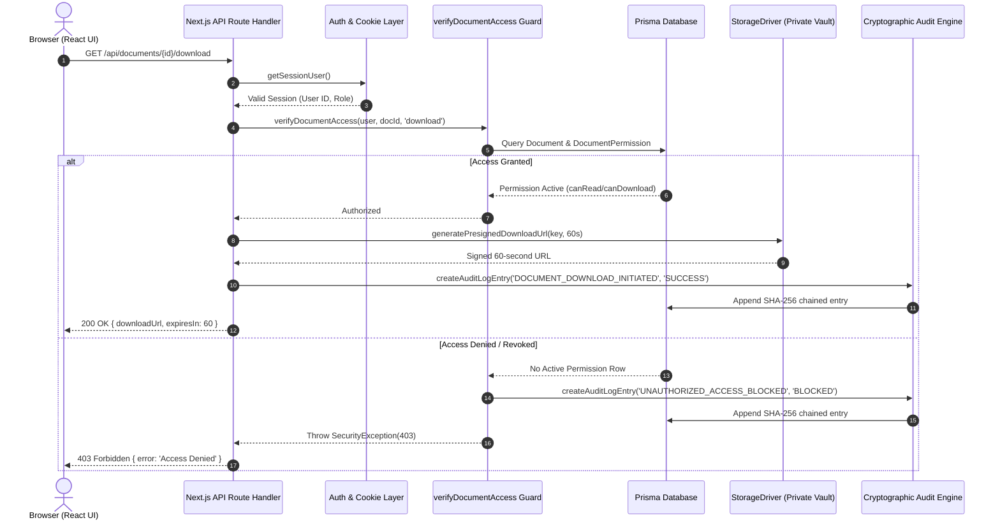
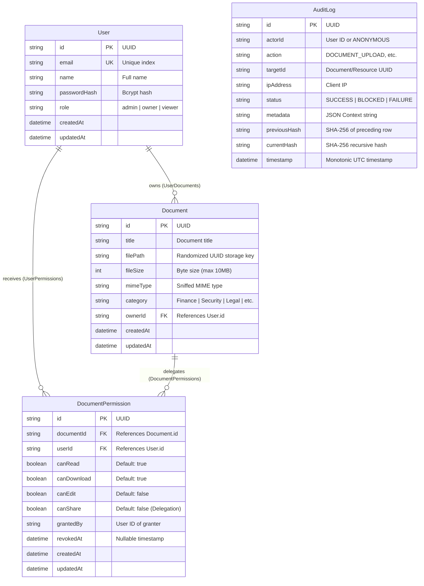

# TrustVault: Frontend, Backend & Database Architecture

## 1. Frontend Architecture & UI Implementation

TrustVault's frontend is built with React 18 and Next.js 14 App Router, using TypeScript for end-to-end type safety and Tailwind CSS for a cyber-defense dark vault design system.

### 1.1 Directory & Folder Organization

```
src/
├── app/                              # Next.js App Router Root
│   ├── admin/page.tsx                # Admin Audit & Compliance Center
│   ├── api/                          # Backend REST Route Handlers
│   │   ├── ai/suggest-permissions/   # Safe AI permission suggester
│   │   ├── audit/                    # Scoped audit query & verification
│   │   ├── auth/                     # Login, logout, session verification
│   │   ├── documents/                # Ingestion, listing, download, stream, view
│   │   ├── reports/                  # Aggregated compliance reporting
│   │   └── users/                    # Public organizational user directory
│   ├── dashboard/page.tsx            # Role-aware Vault Dashboard (Documents, Audit, Reports)
│   ├── login/page.tsx                # Authentication Portal
│   ├── globals.css                   # Global styles, variables, scrollbar styling
│   ├── layout.tsx                    # Root HTML layout & fonts
│   └── page.tsx                      # Root conditional router
├── components/                       # Modular Client Components
│   ├── DocumentViewModal.tsx         # Document metadata reader modal
│   ├── Navbar.tsx                    # Persistent header & quick test switcher
│   ├── PermissionModal.tsx           # Instant revocation & AI helper modal
│   └── UploadModal.tsx               # Drag-and-drop file upload modal
├── lib/                              # Core Backend Services & Business Logic
│   ├── ai.ts                         # Human-in-the-loop suggestion engine
│   ├── audit.ts                      # SHA-256 hash chaining & verification
│   ├── auth.ts                       # JWT issuance & password hashing
│   ├── crypto.ts                     # Magic bytes sniffing & HMAC signing
│   ├── guards.ts                     # Zero-Leak authorization guard
│   ├── prisma.ts                     # Prisma ORM singleton instance
│   └── storage.ts                    # Local & S3/R2 storage abstraction
└── types/                            # Global TypeScript declarations
```

---

### 1.2 Core Pages & Dashboards

#### 1. Authentication Portal ([`src/app/login/page.tsx`](file:///c:/Users/chinnari/Desktop/snovasys/src/app/login/page.tsx))
* **Functionality:** Provides a secure sign-in portal. Displays email and password input fields, animated error banners for failed logins, and an interactive **Preset Test Account Switcher** (Admin, Owner, Viewer, Unauthorized) that auto-populates credentials for demonstration and assessment purposes.
* **Security Behavior:** Submits credentials to `POST /api/auth/login`. On success, the backend sets an `HttpOnly`, `SameSite=Lax` cookie and the client redirects to `/dashboard`.

#### 2. Main Vault Dashboard ([`src/app/dashboard/page.tsx`](file:///c:/Users/chinnari/Desktop/snovasys/src/app/dashboard/page.tsx))
The primary interface for users, dynamically adapting its UI based on the authenticated role:
* **For Document Owners:**
  * **Tab 1: Documents:** Browse owned documents, search by title, filter by category (`Finance`, `Security`, `Legal`, etc.), upload new files, open the **Access Management Modal**, view document details, initiate secure downloads, or run the interactive **IDOR Security Probe**.
  * **Tab 2: Audit Logs:** Real-time log table showing all events affecting the Owner's documents (downloads, views, permission grants, and blocked intrusions).
  * **Tab 3: Compliance:** Runs the live cryptographic chain verification and renders the green immutable ledger status banner.
  * **Tab 4: Reports:** Executive metrics showing upload counts, active downloaders, timeline charts, and blocked security incidents.
* **For Viewers:**
  * Renders a focused view showing **only documents explicitly granted to that Viewer** by an Owner.
  * If an unauthorized user logs in, the dashboard renders the **Zero-Leak Boundary Enforced** screen with zero documents shown and an interactive "Test IDOR Probe" button to verify server-side blocking.

#### 3. Admin Audit & Compliance Center ([`src/app/admin/page.tsx`](file:///c:/Users/chinnari/Desktop/snovasys/src/app/admin/page.tsx))
* **Functionality:** Dedicated interface for System Administrators and Compliance Officers.
* **Components & Views:**
  * **Global Audit Ledger:** Paginated, filterable table of all system events (`UNAUTHORIZED_ACCESS_BLOCKED`, `DOCUMENT_DOWNLOAD_INITIATED`, `PERMISSION_GRANT`, etc.).
  * **JSON Metadata Inspector:** Expandable drawer for any log row to inspect IP addresses, actors, target document IDs, and security violation details.
  * **One-Click Cryptographic Chain Verifier:** Triggers a full mathematical re-hash of all audit entries from the Genesis block to head, confirming 100% data immutability.
  * **Enterprise Reports:** Global aggregated analytics across all tenants and workspaces.

---

### 1.3 Key UI Components

1. **[`Navbar.tsx`](file:///c:/Users/chinnari/Desktop/snovasys/src/components/Navbar.tsx):**
   * Displays the TrustVault brand identity, active user badge with color-coded roles (`purple` for Admin, `emerald` for Owner, `blue` for Viewer), and navigation links.
   * Includes the **One-Click Quick Switcher**, allowing instant role switching during technical assessments without manually typing passwords.

2. **[`UploadModal.tsx`](file:///c:/Users/chinnari/Desktop/snovasys/src/components/UploadModal.tsx):**
   * Provides drag-and-drop file selection with client-side checks for file size (max 10MB) and allowed extensions (`.pdf`, `.docx`, `.xlsx`, `.png`, `.jpg`, `.txt`, `.csv`).
   * Categorizes the upload and sends a multi-part `FormData` POST request to `/api/documents/upload`.

3. **[`PermissionModal.tsx`](file:///c:/Users/chinnari/Desktop/snovasys/src/components/PermissionModal.tsx):**
   * Manages access delegation. Lists current users with active permissions.
   * Features **Instant Revocation** buttons that immediately delete permissions.
   * Contains the **AI Access Governance Assistant** button, which fetches candidate reviewer suggestions and allows the Owner to review and confirm them.

4. **[`DocumentViewModal.tsx`](file:///c:/Users/chinnari/Desktop/snovasys/src/components/DocumentViewModal.tsx):**
   * Secure metadata reader dialog. When opened, it triggers `POST /api/documents/[id]/view`, recording a `DOCUMENT_VIEW` event in the audit trail.

---

## 2. Backend Architecture & API Specifications

The backend is built as RESTful Route Handlers under `src/app/api/` running on the Node.js server runtime.

### 2.1 Complete API Endpoints Table

| Method | Endpoint Route | Purpose | Authentication | Permitted Roles | Handled In |
| :--- | :--- | :--- | :--- | :--- | :--- |
| **POST** | `/api/auth/login` | Authenticate user, verify bcrypt hash, set JWT cookie | None (Public) | All | `auth/login/route.ts` |
| **POST** | `/api/auth/logout` | Clear session cookie and invalidate session | None | All | `auth/logout/route.ts` |
| **GET** | `/api/auth/me` | Return decoded claims of currently authenticated user | JWT Cookie | All | `auth/me/route.ts` |
| **GET** | `/api/documents` | List accessible documents (filtered by Zero-Leak rules) | JWT Cookie | Owner, Admin, Viewer | `documents/route.ts` |
| **POST** | `/api/documents/upload` | Upload document with magic byte sniffing & private storage | JWT Cookie | Owner, Admin | `documents/upload/route.ts` |
| **GET** | `/api/documents/[id]/download` | Authorize and issue timed presigned URL (max 60 seconds) | JWT Cookie | Owner, Permitted Viewers/Admins | `documents/[id]/download/route.ts` |
| **POST** | `/api/documents/[id]/view` | Record document view event and return document metadata | JWT Cookie | Owner, Permitted Viewers/Admins | `documents/[id]/view/route.ts` |
| **GET** | `/api/documents/[id]/permissions` | Retrieve list of granted permissions for a document | JWT Cookie | Owner, Admin (with canShare) | `documents/[id]/permissions/route.ts` |
| **POST** | `/api/documents/[id]/permissions` | Grant or update access permissions for a user | JWT Cookie | Owner, Admin (with canShare) | `documents/[id]/permissions/route.ts` |
| **DELETE** | `/api/documents/[id]/permissions` | Instantly revoke access permissions for a user | JWT Cookie | Owner, Admin (with canShare) | `documents/[id]/permissions/route.ts` |
| **GET** | `/api/documents/stream` | Stream raw file bytes via HMAC-signed 60s proxy | HMAC Token | Verified Token User | `documents/stream/route.ts` |
| **GET** | `/api/audit` | Query audit logs (scoped by role: Owner=own docs, Admin=all) | JWT Cookie | Owner, Admin | `audit/route.ts` |
| **POST** | `/api/audit/verify` | Re-compute and verify the SHA-256 cryptographic chain | JWT Cookie | Owner, Admin | `audit/verify/route.ts` |
| **GET** | `/api/reports` | Generate aggregated compliance analytics and history | JWT Cookie | Owner, Admin | `reports/route.ts` |
| **POST** | `/api/ai/suggest-permissions` | Suggest candidate reviewers based on category/title | JWT Cookie | Owner, Admin | `ai/suggest-permissions/route.ts` |
| **GET** | `/api/users` | List eligible organization users for permission delegation | JWT Cookie | Owner, Admin | `users/route.ts` |

---

### 2.2 Request & Response Lifecycle



---

## 3. Database Schema & Document Storage Architecture

The database is managed using Prisma ORM with SQLite for local development and ready-to-deploy SQL scripts for PostgreSQL with Row-Level Security in production.

### 3.1 Entity Relationship Diagram



### 3.2 Schema Models Explanation

1. **`User` Model:**
   * Holds user identity, role, and salted password hash.
   * Indexed by `role` and `email` for rapid authentication lookups.
2. **`Document` Model:**
   * Stores document metadata. The `filePath` column contains a non-deterministic random key (e.g., `doc_1ece000d-565a-448f...pdf`) rather than the user's original filename, preventing directory traversal and filename collision attacks.
3. **`DocumentPermission` Model:**
   * Represents delegated access. Contains a compound unique index `@@unique([documentId, userId])` ensuring $O(1)$ lookup performance and preventing duplicate permissions.
   * Cascading deletes (`onDelete: Cascade`) ensure that when a document is deleted, all permission records are cleaned up automatically.
4. **`AuditLog` Model:**
   * Append-only ledger recording all security events.
   * `previousHash` and `currentHash` link each record to the preceding row mathematically.

### 3.3 Where Files Are Stored
* **Local Development:** Files are stored in the private directory [`vault_storage/`](file:///c:/Users/chinnari/Desktop/snovasys/vault_storage) outside the public web root. Direct HTTP requests cannot reach this directory.
* **Production Deployment:** Plugs seamlessly into AWS S3 or Cloudflare R2 private buckets. Public access is permanently blocked (`BlockPublicAcls = true`), and access is granted only through 60-second presigned URLs.
