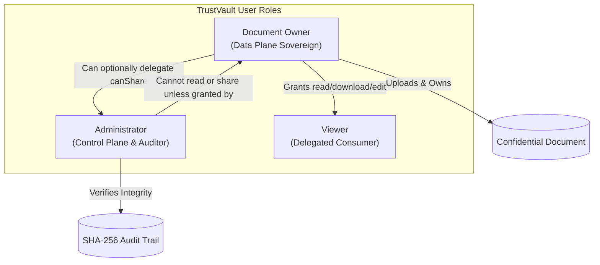

# TrustVault: Project Overview & Core Concept Document

## 1. Executive Summary

**TrustVault** is an enterprise-grade, ultra-secure document storage, sharing, and compliance platform architected from the ground up under a **Zero-Trust security model** and the **Data Custodianship principle**. 

Unlike conventional cloud storage drives or basic web uploaders that treat authorization as a secondary check, TrustVault enforces **live, database-backed authorization on every request**, ensures **instant zero-latency permission revocation**, houses files in **completely private storage with zero direct public access**, and binds all document activities into an **immutable, mathematically verifiable SHA-256 cryptographic audit chain**.

```
┌──────────────────────────────────────────────────────────────────────────────┐
│                              TRUSTVAULT CORE PILLARS                         │
├──────────────────────┬──────────────────────┬────────────────────────────────┤
│      Zero-Trust      │  Data Custodianship  │       Cryptographic Audit      │
│     Architecture     │    (Owner Sovereignty)│       (Tamper-Evident Chain)   │
├──────────────────────┼──────────────────────┼────────────────────────────────┤
│ Every single request │ The document owner   │ Every upload, download, view,  │
│ verifies permissions │ is the sole master   │ and IDOR probe is hashed with  │
│ against the database │ of their files; no   │ SHA-256 and linked to the      │
│ on the active thread.│ admin can bypass it. │ preceding record's hash.       │
└──────────────────────┴──────────────────────┴────────────────────────────────┘
```

---

## 2. The Problem Statement: Why Secure Document Storage is Critical

In modern organizations, confidential documents—such as board meeting minutes, employee compensation ledgers, intellectual property source blueprints, and legal acquisition agreements—are constantly shared across departments, contractors, and executives.

### Critical Vulnerabilities in Conventional Document Platforms

1. **Insecure Direct Object References (IDOR / BOLA):**
   * *The Problem:* Most typical web apps use predictable document IDs (e.g., `/api/documents/1024` or `/files/invoice.pdf`). An unauthorized user simply changes the ID in the URL to view another user's private files.
   * *The Risk:* Catastrophic data leaks (OWASP Top 10 #1: Broken Access Control).

2. **Zombie Access (Revocation Latency):**
   * *The Problem:* When a company revokes an employee's access or terminates a vendor contract, the access token or cached permissions in distributed Redis/CDN nodes often persist for minutes or hours.
   * *The Risk:* The terminated party can still download confidential files during this "window of vulnerability."

3. **Public Cloud Storage Bucket Leaks:**
   * *The Problem:* File uploads are placed in Amazon S3 or Google Cloud Storage with public read access or long-lived static URLs. Anyone who intercepts or guesses the link can bypass the application entirely.
   * *The Risk:* Unauthorized bucket scraping and compliance fines (e.g., GDPR, HIPAA).

4. **Audit Log Tampering & Repudiation:**
   * *The Problem:* Typical database audit tables can be modified or deleted directly using SQL by a rogue administrator, compromised database service account, or SQL injection attack.
   * *The Risk:* Attackers cover their tracks, leaving compliance officers and digital forensic teams with no proof of a breach.

5. **Polyglot & File Masquerading Attacks:**
   * *The Problem:* Systems often only check file extensions (`.pdf`, `.png`). Attackers upload an executable binary (`malware.exe`) renamed to `report.pdf`.
   * *The Risk:* Remote code execution (RCE) or client-side drive-by malware infections.

6. **Overprivileged System Administrators:**
   * *The Problem:* Traditional IT systems grant system administrators unconditional "God Mode" access to read every document on the server.
   * *The Risk:* IT personnel can read private executive salaries, trade secrets, or client data without authorization from the document author.

---

## 3. Project Objectives & Scope

### 3.1 Primary Objectives
* **Eliminate IDOR/BOLA Completely:** Implement live database authorization checks on the server thread for every action (`GET`, `POST`, `VIEW`, `DOWNLOAD`).
* **Guarantee Instant Revocation:** When an owner revokes access, deletion takes effect in the database immediately, resulting in an instant `403 Forbidden` on the very next millisecond request.
* **Keep Storage 100% Private:** Never expose public direct URLs. Files are served exclusively via timed presigned URLs or cryptographically signed HMAC tokens valid for a **maximum of 60 seconds**.
* **Provide Mathematical Proof of Audit Integrity:** Chain audit entries using recursive SHA-256 hashes anchored to a known Genesis Block, allowing one-click tamper verification.
* **Implement Deep Binary Inspection:** Use magic byte sniffing on the raw file buffer to reject disguised executables or corrupt files before storage.
* **Enforce Safe Human-in-the-Loop AI:** Use AI to suggest appropriate reviewers based on metadata, while guaranteeing the AI has zero write authority to the database.

### 3.2 Scope of the Application
* **In Scope:**
  * Multi-role authentication (Owner, Admin, Viewer) with secure HttpOnly cookies.
  * Role-based and owner-controlled document lifecycle management (Upload, Categorization, View, Download).
  * Granular permission management (`canRead`, `canDownload`, `canEdit`, `canShare`).
  * Scoped Audit Logs and Compliance Reports for both Document Owners and Administrators.
  * SHA-256 cryptographic hash chain verification engine.
  * 100% automated security test harness verifying authorization boundaries, IDOR prevention, and tamper detection.
* **Out of Scope:**
  * End-to-end client-side zero-knowledge document body encryption (requires in-browser WebCrypto key management).
  * Real-time collaborative multi-user in-browser document editing (like Google Docs).
  * Multi-region distributed database clustering.

---

## 4. Intended Users & Responsibilities

TrustVault categorizes users into three distinct roles, enforcing **Separation of Duties (SoD)**:



### 1. Document Owner (`role: owner`)
* **Core Philosophy:** The Owner is the **sole data custodian** of their documents.
* **Responsibilities:**
  * Uploads confidential documents and assigns classification categories (`Finance`, `Security`, `Legal`, `Engineering`, `Executive`, `General`).
  * Retains exclusive authority to delete their documents.
  * Grants granular access rights to Viewers (`canRead`, `canDownload`, `canEdit`).
  * Can optionally delegate management rights (`canShare: true`) to an Admin.
  * Monitors the **Owner Compliance Center**, reviewing access history, downloads, views, and blocked security incidents strictly scoped to their documents.
  * Triggers AI-assisted reviewer recommendations and reviews them with human-in-the-loop confirmation.

### 2. Administrator (`role: admin`)
* **Core Philosophy:** The Admin is the **system controller and auditor**, NOT an unrestricted data eavesdropper.
* **Responsibilities:**
  * Manages system-wide health, user directories, and storage infrastructure.
  * Accesses the **Admin Audit & Compliance Center** to review global platform logs and security alarms (`UNAUTHORIZED_ACCESS_BLOCKED`).
  * Executes the **One-Click Cryptographic Chain Verifier** to mathematically verify that database logs have not been manipulated.
  * Generates organization-wide compliance summary reports.
  * **Zero-Trust Constraint:** The Admin **cannot read, download, or delegate access to an Owner's documents** unless the Owner has explicitly granted them permissions in the database.

### 3. Viewer (`role: viewer`)
* **Core Philosophy:** The Viewer is a **least-privilege consumer**.
* **Responsibilities:**
  * Signs in to view documents explicitly delegated to them by Document Owners.
  * Can view document details in a read modal or download the file if granted `canDownload`.
  * Cannot upload documents, alter permissions, or inspect audit logs.
  * Any attempt to probe unpermitted files triggers an IDOR violation and logs a permanent security incident.

---

## 5. How TrustVault Differs from Conventional Document Storage

| Feature | Conventional File Sharing (e.g., Google Drive, Basic Web Apps) | TrustVault Secure Vault |
| :--- | :--- | :--- |
| **Authorization Check** | Often cached in memory or client-side tokens; prone to stale access. | **Live Database Authorization:** Every request (`GET`, `POST`, `DOWNLOAD`) queries the database on the active thread. |
| **Permission Revocation** | Delayed propagation (zombie access persists until token or cache expires). | **Instant Zero-Delay Revocation:** Deleting the permission row invalidates access within milliseconds. |
| **File Storage Exposure** | Static or long-lived URLs; public bucket access misconfigurations common. | **Completely Private Storage:** Zero public URLs. Served only via temporary signed URLs expiring in **max 60 seconds**. |
| **Audit Log Reliability** | Standard database rows; easily modified or deleted by DBAs or SQL injection. | **Cryptographic Hash Chain:** SHA-256 recursive chaining. Modifying past rows breaks the mathematical chain instantly. |
| **File Header Validation** | Extension-only checking (`.pdf`) or trusting client-supplied MIME headers. | **Server-Side Magic Byte Sniffing:** Inspects the first 8 bytes of raw file buffers to detect polyglot/executable payloads. |
| **Admin Privilege Level** | Superadmin has unrestricted "God Mode" to inspect all user documents. | **Data Custodianship:** Admin cannot read or share documents unless explicitly permitted by the document Owner. |
| **AI Role** | Autonomous agents with unrestricted database write authority. | **Human-in-the-Loop:** AI can only advise; human owner confirmation is mandatory for all permission changes. |

---

## 6. Real-World Use Cases

1. **Corporate Finance & M&A Due Diligence:**
   * Investment banking teams share sensitive Q3 audit reports, valuation models, and merger terms with external legal counsel.
   * Access is instantly revoked when negotiations conclude.
   * Every view and download is cryptographically tracked for SEC/FINRA regulatory readiness.

2. **Healthcare & Patient Medical Records:**
   * Medical institutions share patient records with specialized consulting surgeons.
   * Presigned streaming links expire in 60 seconds, preventing link forwarding.
   * Unauthorized probing is immediately trapped and logged for HIPAA compliance.

3. **Intellectual Property & Defense Contracting:**
   * Engineering teams safeguard core hardware schematics and cryptographic keys.
   * File validation ensures disguised executables or firmware exploits cannot be uploaded into corporate infrastructure.

4. **Legal Compliance & Forensic Auditing:**
   * Compliance officers provide third-party external auditors with mathematical proof that log records have not been altered or deleted since the genesis block.
