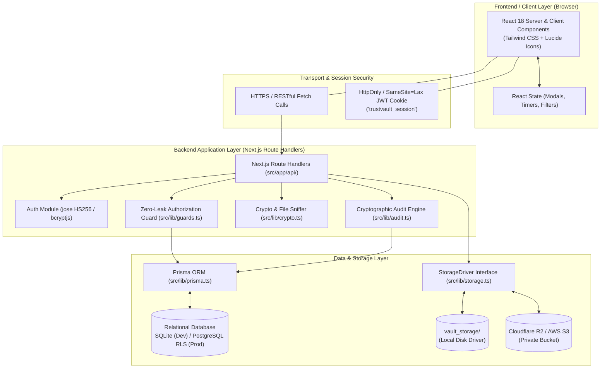

# TrustVault: Complete Technology Stack & System Architecture

## 1. System Architecture Overview

TrustVault uses a modern, decoupled full-stack architecture built on Next.js 14 App Router, TypeScript, Prisma ORM, and modular private object storage.



---

## 2. Technology Stack Breakdown

### 2.1 Frontend Framework & Language

#### 1. Next.js (Version 14.2.15)
* **What it is:** A React framework for building production full-stack web applications using the App Router (`app/` directory).
* **Why it is used:** Provides hybrid Server and Client Components, file-system based routing, unified API route handlers, and optimized asset bundling.
* **Where it is used:** The entire application root in [`src/app`](file:///c:/Users/chinnari/Desktop/snovasys/src/app).
* **How it communicates:** Renders React components on the frontend, routes user requests, and delegates data calls to backend API routes (`/api/*`).
* **Source Code Example ([`src/app/page.tsx`](file:///c:/Users/chinnari/Desktop/snovasys/src/app/page.tsx)):**
  ```typescript
  import { redirect } from 'next/navigation';
  import { getSessionUser } from '@/lib/auth';

  export default async function HomePage() {
    const user = await getSessionUser();
    if (user) {
      redirect('/dashboard');
    } else {
      redirect('/login');
    }
  }
  ```

#### 2. React (Version 18.3.1)
* **What it is:** The component-based declarative UI library.
* **Why it is used:** Manages interactive user interfaces, reactive modal displays, live countdown timers for 60-second download URLs, and active tab switching.
* **Where it is used:** All interactive views: [`src/app/dashboard/page.tsx`](file:///c:/Users/chinnari/Desktop/snovasys/src/app/dashboard/page.tsx), [`src/app/admin/page.tsx`](file:///c:/Users/chinnari/Desktop/snovasys/src/app/admin/page.tsx), and all modal components in `src/components/`.
* **How it communicates:** Uses React Hooks (`useState`, `useEffect`) to hold state and asynchronously communicate with Next.js API endpoints via `fetch()`.
* **Source Code Example ([`src/app/dashboard/page.tsx`](file:///c:/Users/chinnari/Desktop/snovasys/src/app/dashboard/page.tsx#L96-L105)):**
  ```typescript
  // 60-second download countdown timer in React
  useEffect(() => {
    if (!activeDownload) return;
    const interval = setInterval(() => {
      setActiveDownload((prev) => {
        if (!prev) return null;
        if (prev.expiresIn <= 1) {
          return null; // Expired, remove from UI
        }
        return { ...prev, expiresIn: prev.expiresIn - 1 };
      });
    }, 1000);
    return () => clearInterval(interval);
  }, [activeDownload]);
  ```

#### 3. TypeScript (Version 6.0.3)
* **What it is:** Strongly-typed programming language that builds on JavaScript.
* **Why it is used:** Enforces compile-time type safety across database models, user roles, API response bodies, and security parameters, preventing runtime crashes.
* **Where it is used:** Across all files in `src/` and `tests/`.
* **Source Code Example ([`src/lib/guards.ts`](file:///c:/Users/chinnari/Desktop/snovasys/src/lib/guards.ts#L5-L11)):**
  ```typescript
  export type DocumentAction = 'read' | 'download' | 'edit' | 'delete' | 'manage_permissions' | 'share';

  export interface GuardActor {
    id: string;
    role: UserRole;
    email?: string;
  }
  ```

---

### 2.2 Backend Framework & Server Runtime

#### 1. Node.js Runtime (Tested on v22.20.0 LTS)
* **What it is:** Server-side asynchronous event-driven JavaScript/TypeScript runtime.
* **Why it is used:** Executes backend business logic, handles cryptographic hashing, processes raw binary file buffers, and performs database queries.
* **Where it is used:** Powers the Next.js server runtime, API routes, and Vitest test environment.

#### 2. Next.js Route Handlers (`src/app/api/`)
* **What it is:** Standardized HTTP handler functions (`GET`, `POST`, `DELETE`) operating on web standard `Request` and `Response` objects.
* **Why it is used:** Exposes RESTful APIs without needing an external Express.js server, keeping frontend and backend unified in a single codebase.
* **Where it is used:** All files in [`src/app/api`](file:///c:/Users/chinnari/Desktop/snovasys/src/app/api).
* **Source Code Example ([`src/app/api/documents/[id]/download/route.ts`](file:///c:/Users/chinnari/Desktop/snovasys/src/app/api/documents/[id]/download/route.ts#L7-L35)):**
  ```typescript
  export async function GET(req: NextRequest, { params }: { params: { id: string } }) {
    const user = await getSessionUser();
    if (!user) {
      return NextResponse.json({ error: 'Authentication required.' }, { status: 401 });
    }
    // Verify live DB access before issuing 60s download URL
    const { document } = await verifyDocumentAccess(user, params.id, 'download', ip);
    // ...
  }
  ```

---

### 2.3 Database & Data Storage

#### 1. Prisma ORM (Version 5.21.1)
* **What it is:** Next-generation Node.js and TypeScript Object-Relational Mapper (ORM).
* **Why it is used:** Provides type-safe database queries, schema migrations, and declarative relation modeling between users, documents, permissions, and audit logs.
* **Where it is used:** Initialized as a singleton in [`src/lib/prisma.ts`](file:///c:/Users/chinnari/Desktop/snovasys/src/lib/prisma.ts) and imported throughout all backend services.
* **Source Code Example ([`src/lib/prisma.ts`](file:///c:/Users/chinnari/Desktop/snovasys/src/lib/prisma.ts)):**
  ```typescript
  import { PrismaClient } from '@prisma/client';

  const globalForPrisma = globalThis as unknown as { prisma: PrismaClient | undefined };
  export const prisma = globalForPrisma.prisma ?? new PrismaClient();
  if (process.env.NODE_ENV !== 'production') globalForPrisma.prisma = prisma;
  ```

#### 2. SQLite (Local Development & Automated Testing)
* **What it is:** A zero-configuration, serverless, self-contained SQL database engine stored in `prisma/dev.db`.
* **Why it is used:** Enables instant local onboarding, offline unit testing, and fast CI/CD execution without configuring a separate database server.

#### 3. PostgreSQL with Row-Level Security (RLS) (Production Configuration)
* **What it is:** Enterprise relational database system with native row-level access control.
* **Why it is used:** Provides multi-tenant security enforcement directly at the SQL engine level.
* **Where it is defined:** [`prisma/schema.postgresql.prisma`](file:///c:/Users/chinnari/Desktop/snovasys/prisma/schema.postgresql.prisma) and [`prisma/rls_policies.sql`](file:///c:/Users/chinnari/Desktop/snovasys/prisma/rls_policies.sql).

---

### 2.4 Styling, Design System & Icons

#### 1. Tailwind CSS (Version 3.4.14) & PostCSS
* **What it is:** A utility-first CSS framework.
* **Why it is used:** Delivers rapid, responsive, and consistent styling without writing large disconnected CSS files.
* **Where it is configured:** [`tailwind.config.ts`](file:///c:/Users/chinnari/Desktop/snovasys/tailwind.config.ts) and [`src/app/globals.css`](file:///c:/Users/chinnari/Desktop/snovasys/src/app/globals.css).
* **Design Palette:** Uses a custom "Cyber-Vault" dark color palette:
  * `vault`: Emerald greens (`#10b981`, `#047857`) symbolizing verified security.
  * `shield`: Deep slate blues (`#0f172a`, `#020617`, `#1e293b`) creating a high-contrast cyber-defense aesthetic.
* **Source Code Example ([`tailwind.config.ts`](file:///c:/Users/chinnari/Desktop/snovasys/tailwind.config.ts#L14-L28)):**
  ```typescript
  colors: {
    vault: {
      50: "#f0fdf4",
      500: "#10b981",
      700: "#047857",
      900: "#064e3b",
    },
    shield: {
      800: "#1e293b",
      900: "#0f172a",
      950: "#020617",
    }
  }
  ```

#### 2. Lucide React (Version 0.453.0)
* **What it is:** A clean, lightweight open-source icon set for React.
* **Why it is used:** Visual indicators for security shields, locks, downloads, file categories, verified badges, and audit alerts.
* **Where it is used:** Across all UI components (`Navbar.tsx`, `DashboardPage`, `AdminPage`).

---

### 2.5 Authentication, Cryptography & Security Libraries

#### 1. `jose` (Version 5.9.6)
* **What it is:** A Universal Cryptographic library for JSON Web Tokens (JWT).
* **Why it is used:** Signs and verifies session tokens using HMAC-SHA256 (`HS256`) with a 256-bit secret key, enforcing 8-hour session expiration.
* **Where it is used:** [`src/lib/auth.ts`](file:///c:/Users/chinnari/Desktop/snovasys/src/lib/auth.ts).
* **Source Code Example ([`src/lib/auth.ts`](file:///c:/Users/chinnari/Desktop/snovasys/src/lib/auth.ts#L36-L47)):**
  ```typescript
  export async function createSessionToken(user: SessionUser): Promise<string> {
    return new jose.SignJWT({
      id: user.id,
      email: user.email,
      name: user.name,
      role: user.role,
    })
      .setProtectedHeader({ alg: 'HS256' })
      .setIssuedAt()
      .setExpirationTime('8h')
      .sign(JWT_SECRET);
  }
  ```

#### 2. `bcryptjs` (Version 2.4.3)
* **What it is:** An optimized implementation of bcrypt password hashing.
* **Why it is used:** Secures user passwords with strong salt rounds (10), defending against brute-force and rainbow table attacks.
* **Where it is used:** [`src/lib/auth.ts`](file:///c:/Users/chinnari/Desktop/snovasys/src/lib/auth.ts) and [`prisma/seed.js`](file:///c:/Users/chinnari/Desktop/snovasys/prisma/seed.js).

#### 3. Native Node.js `crypto` Module
* **What it is:** Node's built-in cryptographic library.
* **Why it is used:**
  1. Computes deterministic SHA-256 hashes for the immutable audit trail chain.
  2. Generates HMAC-SHA256 signed tokens for local streaming URLs.
  3. Executes constant-time comparisons (`crypto.timingSafeEqual`) to prevent timing attack vulnerabilities.
* **Where it is used:** [`src/lib/crypto.ts`](file:///c:/Users/chinnari/Desktop/snovasys/src/lib/crypto.ts).

---

### 2.6 Storage Mechanisms & Drivers

TrustVault implements a modular **StorageDriver** interface in [`src/lib/storage.ts`](file:///c:/Users/chinnari/Desktop/snovasys/src/lib/storage.ts):

```typescript
export interface StorageDriver {
  saveFile(key: string, buffer: Buffer, mimeType: string): Promise<string>;
  getFileStream(key: string): Promise<ReadableStream | NodeJS.ReadableStream | Buffer>;
  generatePresignedDownloadUrl(key: string, documentId: string, userId: string, filename: string, expiresInSeconds?: number): Promise<string>;
  deleteFile(key: string): Promise<void>;
}
```

1. **`LocalStorageDriver`:**
   * Used for local offline development.
   * Stores files in `vault_storage/` with non-deterministic UUID keys (`doc_<uuid>.<ext>`).
   * Issues HMAC-SHA256 signed streaming URLs pointing to `/api/documents/stream` valid for a max of 60 seconds.
2. **`S3StorageDriver` (`@aws-sdk/client-s3` and `@aws-sdk/s3-request-presigner`):**
   * Used for enterprise production deployments with Cloudflare R2 or AWS S3 private buckets.
   * Connects using AWS SDK v3 and generates standard S3 presigned download URLs with `expiresIn: 60`.

---

### 2.7 Testing Framework

#### Vitest (Version 2.1.3)
* **What it is:** A high-speed, native TypeScript test runner built on Vite.
* **Why it is used:** Executes unit and integration tests verifying authorization boundaries, IDOR defenses, magic byte sniffing, and cryptographic chain tampering.
* **Verification Proof:** All 36 automated tests across 6 suites pass cleanly.
